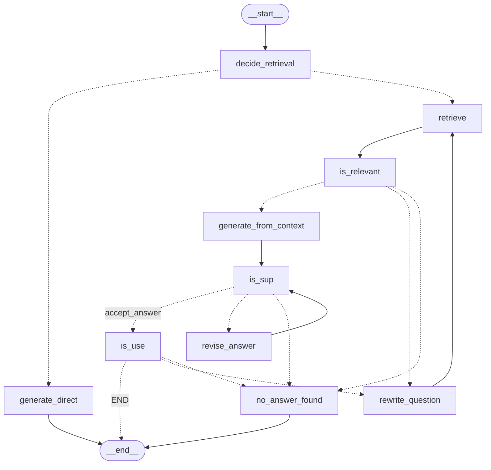

# Self-RAG Company Handbook Assistant

An employee handbook question-answering assistant built with a LangGraph Self-RAG workflow. It decides when company documents are needed, retrieves handbook passages, checks their relevance, and evaluates the generated answer before returning it.

## 1. Description

### What is Self-Reflective RAG?

Retrieval-Augmented Generation (RAG) adds information from external documents to a language model's prompt. Self-Reflective RAG adds decisions and checks around retrieval and generation: the system can decide whether to retrieve, judge retrieved passages, and evaluate whether an answer is supported and useful.

This project is an application-level implementation inspired by the Self-RAG paper. It uses a LangGraph workflow and LLM-based checks; it does not train a model with the paper's reflection tokens.

### Use case

The assistant answers company-policy questions using the employee handbook, such as questions about leave, overtime, work schedules, attendance, and workplace procedures. It can also answer general questions without retrieving handbook passages. When a question combines a handbook request with an unrelated task, it answers the handbook part when supported and declines the unrelated part.

The included sample handbook is `docs/Sample_Employee_Handbook_Valve.pdf`. The Streamlit app can also index uploaded PDF, TXT, Markdown, and DOCX files for the current app session.

### Evaluation results

The following scores are from the saved evaluation artifacts in this repository. They use 30 golden examples per evaluation unless stated otherwise. DeepEval's LLM judge scores are evaluation results, not guarantees of future performance.

| Component                     | Metric           | Score |
| ----------------------------- | ---------------- | ----: |
| Hybrid retriever, K=5         | Recall@5         | 0.933 |
| Hybrid retriever, K=5         | MRR@5            | 0.875 |
| Hybrid retriever, K=5         | Precision@5      | 0.367 |
| Generator with golden context | Faithfulness     | 0.927 |
| Generator with golden context | Answer relevancy | 0.884 |
| Full Self-RAG quality         | Correctness      | 0.882 |
| Full Self-RAG quality         | Completeness     | 0.885 |
| Full Self-RAG quality         | Style            | 0.742 |

The generator evaluation supplies the golden context directly, so it measures generation quality without measuring retrieval. The full quality evaluation runs the Self-RAG graph against the correctness golden dataset.

In an earlier scope-evaluation iteration, the reported Scope Adherence score improved from **0.45 to 0.95**. The reported Style score improved from **0.69 to 0.74**.

The separate reranker comparison on 30 retrieval questions reported these results at K=5. The saved Self-RAG latency results were measured without the reranker because the cross-encoder added substantial latency.

| Retrieval setup                           | Recall@5 | MRR@5 | Precision@5 |
| ----------------------------------------- | -------: | ----: | ----------: |
| Hybrid retrieval                          |    0.933 | 0.858 |       0.380 |
| Hybrid retrieval + cross-encoder reranker |    0.967 | 0.870 |       0.367 |

## 2. How it works

The Self-RAG graph in `src/self-rag.py` follows this flow:



### Pipeline steps

1. **`decide_retrieval` classifies the request.** The LLM decides whether company documents are needed and returns the in-scope question. If a message combines a handbook question with an unrelated task, it separates the unrelated part. Related subquestions stay together: “Who is eligible for overtime, what is the rate, and who can authorize it?” remains one handbook question.

2. **The graph chooses a response path.** General questions that do not depend on company policy go to `generate_direct`. Company-specific questions go to `retrieve`. The direct-answer prompt limits the assistant to permitted general questions and declines unrelated requests.

3. **`retrieve` finds candidate handbook passages.** It uses the BM25 and Chroma vector hybrid retriever, with equal weights, and passes up to five documents to the next node. If the Chroma collection is empty, the pipeline indexes supported files from `docs/` first. Chunks are stored with source and page metadata.

4. **`is_relevant` filters the candidates.** It asks the LLM to judge each retrieved document against the in-scope question. A passage can be relevant even if it does not contain the complete answer, as long as it could provide useful evidence. Relevant passages continue to generation. If none are relevant, the graph tries a query rewrite and retrieves again; after three rewrites it returns “No answer found.”

5. **`generate_from_context` writes a grounded answer.** It gives the generator the question and all relevant passages. The generator is instructed to use only that context, answer all supported parts, preserve important conditions and numbers, and say “No answer found” when the context has no answer.

6. **`is_sup` checks factual support.** It compares the answer's claims with the supplied passages and returns a support label plus evidence quotes. A fully supported answer continues. A partially supported or unsupported answer goes to `revise_answer`, which removes or corrects unsupported claims. The graph allows up to two revisions; if the answer still fails the support check, it returns “No answer found.”

7. **`is_use` checks whether the answer addresses the question.** If useful, the graph finishes. If it is off-topic or too generic, the graph rewrites the retrieval query and tries again. The shared rewrite limit is three attempts; if the answer remains unhelpful, it returns “No answer found.”

8. **The final response handles any separated unrelated request.** After the graph finishes the in-scope answer, `invoke_self_rag` appends a short decline for the unrelated part. For example, “What is the overtime rate, and give me salary negotiation advice?” can receive the handbook-supported overtime rate followed by “I can't help with salary negotiation advice.”

The checks have separate roles: relevance decides whether a passage may help; support checks whether the answer's claims follow from the passages; usefulness checks whether the answer actually responds to the question. The rewrite loop changes the retrieval query while preserving the user's original question for answer generation.

## 3. Installation and usage

### Requirements

- Python 3.10 or newer
- An OpenAI API key
- Dependencies listed in `requirements.txt`

Create and activate a virtual environment, then install the dependencies:

```bash
python -m venv .venv
source .venv/bin/activate        # macOS/Linux
# .venv\Scripts\activate         # Windows PowerShell
pip install -r requirements.txt
```

Create a `.env` file in the repository root:

```env
OPENAI_API_KEY=your_openai_api_key
```

The `.env` file is ignored by Git. Do not commit API keys. The Streamlit app also provides an API-key field in its sidebar.

### Run the Streamlit app

From the repository root:

```bash
streamlit run app.py
```

Enter an API key in the sidebar, then choose the sample handbook or upload one or more documents. Uploaded documents are embedded after upload and their temporary files and index are removed when the app server stops. Ask a question in the chat; retrieved passages appear under the answer in an expandable Sources section.

### Run a pipeline from the terminal

Run the Self-RAG command-line loop:

```bash
python src/self-rag.py
```

The Self-RAG pipeline indexes files from `docs/` automatically when its Chroma collection is empty. You can also preprocess them directly:

```bash
python src/doc-preprocessing.py
```

### Run evaluations

Run evaluation scripts from the repository root. They use the golden files in `eval/golden/`, call OpenAI models, and may incur API charges.

Self-RAG examples:

```bash
python eval/eval_code/evaluate_retriever.py
python eval/eval_code/evaluate_generator.py
python eval/eval_code/evaluate_self_rag_quality.py
python eval/eval_code/evaluate_self_rag_scope.py
```

The full Self-RAG evaluation scripts are in `eval/eval_code/` and cover retrieval, reranking, generator faithfulness/relevancy, answer quality, scope, toxicity, leakage, latency, and estimated model cost.

Evaluation results are written to `eval/results/`.

## 4. Implementation

### Main technologies

- **Python** for the application and evaluation scripts.
- **LangGraph** for graph-based routing and state management.
- **LangChain** for prompts, model calls, document objects, and retriever interfaces.
- **OpenAI `gpt-4o-mini`** for retrieval decisions, generation, and reflection checks.
- **OpenAI `text-embedding-3-small`** for document and query embeddings.
- **ChromaDB** for persistent vector storage. The database is created locally in `chroma_db/` and is excluded from Git.
- **BM25 + vector hybrid search** for Self-RAG retrieval, combined with equal weights.
- **Cross-encoder reranking** is implemented in `src/reranker.py` using `cross-encoder/ms-marco-MiniLM-L-6-v2`. The reported Self-RAG latency baseline did not use it because it substantially increased latency. It is currently wired into Self-RAG experimentally for checking; compare latency before using it as the default.
- **DeepEval** for faithfulness, answer relevance, quality, scope, toxicity, leakage, and retrieval metric reports.
- **Streamlit** for the chat interface and document upload.

### Document indexing

`src/doc-preprocessing.py` supports PDF, TXT, Markdown, and DOCX. It splits extracted text into chunks of 1,300 characters with 200-character overlap, embeds batches of up to 32 chunks, and stores text, vectors, and page metadata in ChromaDB. The vector embeddings are produced through the OpenAI API; the Chroma database itself is local.

### Golden datasets

Golden datasets are stored in `eval/golden/`:

- `valve_handbook_retriever_golden.jsonl` — retrieval questions and relevant PDF page labels.
- `faithfullness_golden.jsonl` — generator questions with ideal context passages. The filename spelling is retained as it exists in the repository.
- `correctness_golden.jsonl` — questions and reference answers for answer-quality evaluation.
- `scope_golden.jsonl` — in-scope, out-of-scope, and mixed-scope cases.
- `toxicity_golden.jsonl` and `leakage_golden.jsonl` — safety and leakage evaluation cases.
- `valve_handbook_golden.jsonl` — handbook answer examples.

### Paper

This project is inspired by the ideas in Asai et al., [_Self-RAG: Learning to Retrieve, Generate, and Critique through Self-Reflection_](https://arxiv.org/abs/2310.11511) (2023). The paper describes adaptive retrieval and self-reflection to improve factuality and response quality. This repository implements a related workflow with a graph of LLM calls and checks rather than the paper's trained reflection-token model.
